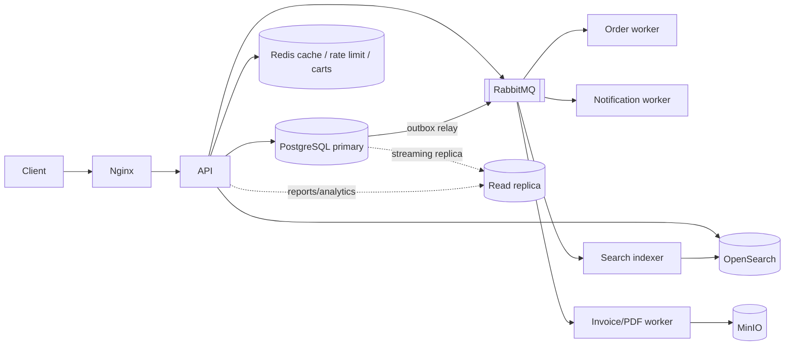

# PRD 01: ShopScale, Multi-Vendor E-commerce Marketplace

**Status:** Draft v1
**Purpose:** Portfolio-grade demo that proves production engineering skills (performance, concurrency, reliability, security), not CRUD skills.
**Stack options:** NestJS (TypeScript), Spring Boot (Java), or Go. The architecture is identical; see Section 3 for per-stack choices.

---

## 1. Overview

### 1.1 Problem
Small and mid-size sellers need a marketplace where customers can browse a large catalog quickly, buy without overselling, and pay reliably, while admins and sellers manage their own scope safely.

### 1.2 Goals
| # | Goal | How it is proven |
|---|------|------------------|
| G1 | Catalog stays fast at 100k+ products | p95 < 150 ms on list/search, documented in EXPLAIN ANALYZE before/after |
| G2 | Never oversell stock under concurrency | Load test: 500 concurrent buyers, 50 units, exactly 50 orders succeed |
| G3 | Payments are safe to retry | Idempotency-key tests, duplicate webhook tests |
| G4 | Real RBAC + resource-level authorization | Permission matrix tests (Section 5) |
| G5 | Order pipeline survives failures | Kill worker mid-flow; system recovers with no lost or duplicated side effects |
| G6 | Operable | Metrics, tracing, structured logs, dashboards, runbook |

### 1.3 Non-goals
Real payment processing (use a mock gateway or Stripe test mode), real shipping carriers, mobile apps, recommendation ML, multi-currency tax compliance.

### 1.4 Success criteria (portfolio)
A reviewer can clone the repo, run `make up && make seed-l`, open the app with 100k products, and reproduce every number in the README with one command.

---

## 2. Personas

| Persona | Description | Key needs |
|---------|-------------|-----------|
| Guest | Anonymous visitor | Browse, search, view product |
| Customer | Registered buyer | Cart, checkout, order history, reviews, returns |
| Seller | Vendor owning a shop | Manage own products, stock, orders, payouts |
| Support agent | Internal staff | View orders/customers, issue refunds within limit |
| Admin | Platform operator | Manage sellers, categories, users, system config, audit logs |

---

## 3. Tech Stack (choose one per implementation)

| Concern | NestJS (TS) | Spring Boot (Java 21) | Go |
|---------|-------------|-----------------------|----|
| HTTP | NestJS + Fastify | Spring Web MVC (virtual threads) or WebFlux | chi or Gin |
| DB access | Prisma or Drizzle + raw SQL for hot paths | Spring Data JPA + jOOQ for hot paths | sqlc + pgx |
| Migrations | Prisma Migrate / node-pg-migrate | Flyway | goose / atlas |
| Queue | BullMQ (Redis) or RabbitMQ | Spring AMQP (RabbitMQ) | asynq or RabbitMQ |
| AuthN | JWT access + rotating refresh (Passport) | Spring Security + JWT | golang-jwt + middleware |
| AuthZ | CASL or custom guards | Spring Security method security + custom PermissionEvaluator | Casbin or custom policy package |
| Validation | class-validator / zod | Jakarta Validation | go-playground/validator |
| Testing | Jest + Testcontainers | JUnit 5 + Testcontainers | testing + testcontainers-go |

**Shared infra (all stacks):** PostgreSQL 16, Redis 7, OpenSearch/Elasticsearch 8 (or Postgres FTS in tier 1), RabbitMQ (or Redis streams), MinIO (S3-compatible), Nginx, Docker Compose, Prometheus + Grafana, OpenTelemetry + Jaeger, k6.

**Frontend (kept intentionally thin):** Next.js storefront + a simple React admin/seller dashboard. The backend is the showpiece.

---

## 4. Architecture

Start as a **modular monolith** with async workers. Do not use microservices; explain why in the README (team size, operational cost). Modules have strict boundaries and communicate via interfaces and domain events.



**Modules:** identity, catalog, inventory, cart, checkout/orders, payments, promotions, reviews, seller-portal, notifications, admin/audit, search.

---

## 5. RBAC and Authorization

### 5.1 Role permissions (coarse)

| Capability | Guest | Customer | Seller | Support | Admin |
|-----------|:----:|:--------:|:------:|:-------:|:-----:|
| Browse/search catalog | Yes | Yes | Yes | Yes | Yes |
| Manage cart / checkout | No | Yes | No | No | No |
| View own orders | No | Yes | No | No | No |
| Create/edit product | No | No | Own only | No | Any |
| Adjust stock | No | No | Own only | No | Any |
| View orders containing own items | No | No | Yes (own items only) | Any | Any |
| Issue refund | No | No | Request | Up to $200 | Unlimited |
| Approve/suspend seller | No | No | No | No | Yes |
| View audit log | No | No | No | Read-only | Yes |
| Manage roles/permissions | No | No | No | No | Yes |

### 5.2 Resource-level rules (ABAC)
- Seller can only read/write products where `product.seller_id = user.seller_id`.
- A seller sees an order only through **order_items** belonging to them; buyer PII (address, phone) is masked until the order is `PAID`.
- Support refund limit is a policy value stored in config, not hard-coded.
- Deny by default; every endpoint declares its required permission; a CI test fails if an endpoint has none.

### 5.3 Implementation requirements
- Permissions are strings (`product:update`, `order:refund`) mapped to roles in DB; roles cached in Redis with invalidation on change.
- JWT access token (15 min) + refresh token rotation with reuse detection.
- Rate limiting per IP and per user (Redis token bucket); stricter on login and checkout.
- A **permission matrix test** iterates every route x every role and asserts expected allow/deny. This is a headline README artifact.

---

## 6. Functional Requirements

Priority: **P0** = must ship, **P1** = should ship, **P2** = stretch.

### 6.1 Identity
| ID | Requirement | P |
|----|-------------|---|
| ID-1 | Register, login, logout, refresh, password reset (argon2id hashing) | P0 |
| ID-2 | Email verification | P1 |
| ID-3 | Refresh token rotation with reuse detection (revoke family) | P0 |
| ID-4 | Account lockout / exponential backoff on failed logins | P1 |
| ID-5 | Seller onboarding flow with admin approval | P0 |

### 6.2 Catalog and Search
| ID | Requirement | P |
|----|-------------|---|
| CT-1 | Product with variants (size/color), images, attributes (JSONB), category tree | P0 |
| CT-2 | List products by category with **cursor (keyset) pagination**, sort by price/newest/popularity | P0 |
| CT-3 | Full-text search with typo tolerance, filters (price range, brand, rating, in-stock), facet counts | P0 |
| CT-4 | Autocomplete suggestions under 50 ms p95 | P1 |
| CT-5 | Product detail page cached with cache-aside + stampede protection | P0 |
| CT-6 | Search index updated asynchronously via events; full reindex command available | P0 |
| CT-7 | Image upload via presigned URLs, async thumbnail generation | P1 |

### 6.3 Inventory
| ID | Requirement | P |
|----|-------------|---|
| IN-1 | Stock tracked per variant with `on_hand` and `reserved` | P0 |
| IN-2 | **Reservation on checkout start** with TTL (default 15 min); expiry job releases stock | P0 |
| IN-3 | Atomic decrement (single conditional UPDATE) so stock never goes negative | P0 |
| IN-4 | Every stock change written to an append-only `stock_movements` ledger | P0 |
| IN-5 | Low-stock alerts to seller | P2 |

### 6.4 Cart
| ID | Requirement | P |
|----|-------------|---|
| CA-1 | Cart stored in Redis for speed, persisted to DB for logged-in users | P0 |
| CA-2 | Guest cart merges into user cart on login | P1 |
| CA-3 | Price and stock revalidated at checkout, never trusted from client | P0 |

### 6.5 Checkout, Orders, Payments
| ID | Requirement | P |
|----|-------------|---|
| OR-1 | Checkout requires `Idempotency-Key` header; replays return the original response | P0 |
| OR-2 | Order state machine: `PENDING -> PAID -> PACKED -> SHIPPED -> DELIVERED`, plus `CANCELLED`, `REFUNDED`; illegal transitions rejected | P0 |
| OR-3 | Mock payment gateway with async webhook; webhook signature verification and dedupe by event id | P0 |
| OR-4 | **Transactional outbox**: order write and event write in one DB transaction; relay publishes to broker | P0 |
| OR-5 | Saga: reserve stock -> charge -> confirm; on failure, compensating actions (release stock, void payment) | P0 |
| OR-6 | Orders split per seller (sub-orders) for fulfillment and payouts | P1 |
| OR-7 | Invoice PDF generated by worker, stored in object storage | P1 |
| OR-8 | Refunds (full/partial) with ledger entries | P1 |
| OR-9 | Coupons: percent/fixed, per-user limit, global limit enforced atomically | P1 |

### 6.6 Reviews and Ratings
| ID | Requirement | P |
|----|-------------|---|
| RV-1 | Only verified purchasers can review; one review per product per user | P0 |
| RV-2 | Aggregate rating stored denormalized on product, updated async | P1 |

### 6.7 Admin, Audit, Notifications
| ID | Requirement | P |
|----|-------------|---|
| AD-1 | Audit log for every privileged mutation (actor, action, entity, before/after JSON, IP, request id) | P0 |
| AD-2 | Admin dashboards: GMV, orders/day, top sellers via read replica / materialized views | P1 |
| AD-3 | Email/SMS notifications through worker with retry + dead-letter queue | P1 |
| AD-4 | Feature flags for gradual rollout | P2 |

---

## 7. Non-Functional Requirements (SLOs)

Measured on the **100k-product tier** on a 4 vCPU / 8 GB laptop-class environment.

| Metric | Target |
|--------|--------|
| Product list (cached) p95 | < 50 ms |
| Product list (cache miss) p95 | < 150 ms |
| Product detail p95 | < 80 ms |
| Search p95 | < 200 ms |
| Add to cart p95 | < 60 ms |
| Checkout p95 | < 500 ms |
| Throughput (mixed browse workload) | >= 1,000 req/s |
| Overselling | 0 incidents in concurrency test |
| Duplicate orders from retry | 0 |
| Error rate under load | < 0.5% |
| Recovery | Worker killed mid-order: order completes within 60 s of restart |
| Test coverage | >= 80% on domain logic; integration tests use real Postgres via Testcontainers |

---

## 8. Data Model (core tables)

```
users(id, email UNIQUE, password_hash, status, created_at)
roles(id, name) / permissions(id, key) / role_permissions(role_id, permission_id)
user_roles(user_id, role_id)
sellers(id, user_id, shop_name, status, commission_rate)
addresses(id, user_id, ...)

categories(id, parent_id, path LTREE or materialized path, name, slug)
products(id, seller_id, category_id, title, slug, brand, description,
         price_cents, currency, status, attributes JSONB,
         rating_avg, rating_count, sales_count, search_vector TSVECTOR,
         created_at, updated_at)
product_variants(id, product_id, sku UNIQUE, price_cents, attributes JSONB)
inventory(variant_id PK, on_hand, reserved, version)
stock_movements(id, variant_id, delta, reason, ref_type, ref_id, created_at)   -- append-only
stock_reservations(id, order_id, variant_id, qty, expires_at, status)

carts / cart_items                          -- DB copy of Redis cart
orders(id, user_id, status, total_cents, currency, idempotency_key UNIQUE(user_id,key), created_at)
order_items(id, order_id, seller_id, variant_id, qty, unit_price_cents)
payments(id, order_id, provider_ref UNIQUE, status, amount_cents)
webhook_events(event_id PK, received_at, processed_at)   -- dedupe
outbox(id, aggregate_type, aggregate_id, event_type, payload JSONB, created_at, published_at)
coupons / coupon_redemptions
reviews(id, product_id, user_id, rating, body, created_at, UNIQUE(product_id,user_id))
audit_logs(id, actor_id, action, entity_type, entity_id, before JSONB, after JSONB, ip, request_id, created_at)
```

### 8.1 Indexes to design deliberately (each documented with EXPLAIN ANALYZE)
- `products (category_id, created_at DESC, id DESC)` for keyset pagination
- `products (category_id, price_cents, id)` for price sort
- Partial index: `products (category_id, sales_count DESC) WHERE status = 'ACTIVE'`
- GIN on `search_vector` and on `attributes` (jsonb_path_ops)
- `orders (user_id, created_at DESC)`
- `order_items (seller_id, created_at DESC)`
- `outbox (created_at) WHERE published_at IS NULL`
- `stock_reservations (expires_at) WHERE status = 'ACTIVE'`

### 8.2 Partitioning
Partition `orders`/`order_items` (or `audit_logs`, `stock_movements`) by month at the 100k+ tier and show partition pruning in a query plan.

---

## 9. Key Engineering Problems and Chosen Solutions

Each row becomes a section in `docs/engineering-decisions.md` with a short ADR (context, options, decision, trade-offs).

| Problem | Naive approach | Chosen solution |
|---------|----------------|-----------------|
| Slow deep pagination | `OFFSET 50000` | Keyset pagination on `(created_at, id)`; benchmark both |
| Overselling | Read stock then write | `UPDATE inventory SET on_hand = on_hand - :q WHERE variant_id=:v AND on_hand >= :q` (0 rows updated means out of stock); reservation table with TTL |
| Hot product contention | Everyone locks one row | Show limits of row lock; optional Redis Lua pre-decrement gate + DB as source of truth |
| Double charge on retry | Retry blindly | Idempotency keys stored with request hash and cached response; unique constraint |
| Dual write (DB + broker) | Publish after commit and hope | Transactional outbox + relay with `FOR UPDATE SKIP LOCKED` |
| Duplicate messages | Assume exactly-once | At-least-once delivery + idempotent consumers (processed-event table) |
| Cache stampede on hot product | Everyone rebuilds cache | Single-flight lock, TTL jitter, stale-while-revalidate |
| Stale cache | TTL only | Event-driven invalidation on product update |
| Search freshness | Sync write to ES in request | Async indexer from events; reindex-from-scratch command |
| N+1 queries | ORM lazy loading | Batched queries / dataloader; a test asserts query count per endpoint |
| Seller data leakage | Filter in UI | Authorization at query layer (repository requires actor scope) |
| Reporting slowing OLTP | Run aggregates on primary | Read replica + materialized views refreshed on schedule |

---

## 10. API Surface (representative)

```
POST   /auth/register | /auth/login | /auth/refresh | /auth/logout
GET    /products?category=&q=&minPrice=&maxPrice=&sort=&cursor=&limit=
GET    /products/:slug
GET    /search?q=&filters...        GET /search/suggest?q=
GET    /cart            POST /cart/items      PATCH/DELETE /cart/items/:id
POST   /checkout                    (Idempotency-Key required)
GET    /orders          GET /orders/:id       POST /orders/:id/cancel
POST   /webhooks/payments           (signature verified)
POST   /seller/products   PATCH /seller/products/:id   POST /seller/inventory/:variantId/adjust
GET    /seller/orders
POST   /admin/sellers/:id/approve   GET /admin/audit-logs   GET /admin/reports/sales
GET    /health/live  /health/ready  /metrics
```

Standards: OpenAPI 3.1 spec generated and published, consistent error format (RFC 7807), API versioning (`/v1`), request-id propagation, pagination envelope with `nextCursor`.

---

## 11. Seed Data Plan

### 11.1 Principles
- **Deterministic:** same seed value gives same dataset (`SEED=42`), so benchmarks are reproducible.
- **Realistic distributions, not uniform random:**
  - Product popularity follows a Zipf/power-law (top 1% of products get ~30% of orders and views).
  - Prices are log-normal per category (e.g., electronics 20 to 2,000, books 5 to 60).
  - Order dates spread over 24 months with weekday and seasonal peaks (Nov/Dec spike).
  - Order size: 60% one item, 25% two, 10% three, 5% four or more.
  - Order status mix: 78% delivered, 8% shipped, 4% paid/packed, 6% cancelled, 4% refunded.
  - Stock: 85% healthy, 10% low (<10), 5% out of stock.
  - Ratings skew positive (J-shaped: many 5s, a tail of 1s).
- **Fast to load:** generate with a script, load with `COPY` (Postgres) rather than row-by-row inserts. Target: Tier L seeded in under 10 minutes.
- **Referentially valid:** generated in dependency order; FK constraints on.
- **Includes deliberately bad queries** (Section 11.4).

### 11.2 Volume tiers

| Entity | Tier S (1k) | Tier M (10k) | Tier L (100k) | Tier XL (stretch, 1M) |
|--------|-------------|--------------|----------------|-----------------------|
| Users (customers) | 1,000 | 10,000 | 100,000 | 1,000,000 |
| Sellers | 20 | 100 | 500 | 2,000 |
| Categories (3-level tree) | 30 | 120 | 400 | 400 |
| Products | 1,000 | 10,000 | 100,000 | 1,000,000 |
| Variants (avg 2.5/product) | 2,500 | 25,000 | 250,000 | 2,500,000 |
| Inventory rows | 2,500 | 25,000 | 250,000 | 2,500,000 |
| Addresses (avg 1.4/user) | 1,400 | 14,000 | 140,000 | 1,400,000 |
| Orders | 5,000 | 100,000 | 1,000,000 | 10,000,000 |
| Order items (avg 1.8/order) | 9,000 | 180,000 | 1,800,000 | 18,000,000 |
| Payments | 5,000 | 100,000 | 1,000,000 | 10,000,000 |
| Stock movements | 20,000 | 400,000 | 4,000,000 | 40,000,000 |
| Reviews | 3,000 | 60,000 | 600,000 | 6,000,000 |
| Coupons | 20 | 100 | 300 | 1,000 |
| Audit log rows | 5,000 | 100,000 | 1,000,000 | 10,000,000 |
| Approx DB size | ~60 MB | ~600 MB | ~6 GB | ~60 GB |

**What each tier is for:**
- **S:** local dev, unit and integration tests, quick demos (`make seed-s`, under 30 seconds).
- **M:** default demo. Enough that missing indexes start to hurt.
- **L:** the headline benchmark tier. All SLOs in Section 7 are measured here.
- **XL:** stretch, show partitioning, replica lag handling and honest limits of a single node.

### 11.3 Fixed demo accounts (all tiers)

| Email | Role | Notes |
|-------|------|-------|
| admin@shopscale.dev | Admin | Full access |
| support@shopscale.dev | Support | Refund limit $200 |
| seller1@shopscale.dev | Seller | Owns ~5% of catalog, has orders in every status |
| seller2@shopscale.dev | Seller | Used to prove cross-seller access is denied |
| customer1@shopscale.dev | Customer | 200+ orders (tests pagination in order history) |
| customer2@shopscale.dev | Customer | Empty account for clean checkout demos |

Shared demo password documented in README; never reused in real environments.

### 11.4 Deliberate "problem" fixtures (for before/after proof)
1. **Deep pagination:** category with 20k products. Compare `OFFSET 19000` vs keyset.
2. **Missing index:** seed with the index migration disabled, run the seller-orders query, show a sequential scan, then apply the index and show an index scan with timings.
3. **Hot product:** one product with 50 units in stock and a `flash-sale` script to fire 500 concurrent checkouts.
4. **N+1 trap:** order-history endpoint that starts naive and is fixed; the query-count test is committed.
5. **Bulk dirty catalog:** CSV of 50k products with 2% invalid rows, to demonstrate validation and error report on bulk import.

### 11.5 Seeder tooling
- Node: `@faker-js/faker` + `pg-copy-streams`
- Java: `datafaker` + PostgreSQL `CopyManager`
- Go: `gofakeit` + `pgx.CopyFrom`
- Output CLI: `make seed SIZE=s|m|l|xl SEED=42`, plus `make seed-verify` that asserts counts, FK integrity and distribution sanity (for example, top 1% of products account for at least 25% of order items).

---

## 12. Performance and Load Testing Plan

Tool: **k6** with scenarios committed under `/loadtests`.

| Scenario | Profile | Pass criteria |
|----------|---------|---------------|
| Browse mix | 70% list, 20% detail, 10% search; ramp to 1,000 req/s for 10 min | p95 within SLO, error < 0.5% |
| Search stress | 200 VUs, random queries from a real-looking term list | p95 < 200 ms |
| Flash sale | 500 concurrent checkouts on 50 units | Exactly 50 successful orders, 0 negative stock, ledger sums correctly |
| Retry storm | Same idempotency key sent 20x concurrently | Exactly 1 order, 1 charge |
| Chaos | Kill worker and restart Redis mid-checkout | No lost orders; no duplicate side effects; recovery < 60 s |
| Soak | 30 min at 40% of peak | No memory growth; stable p95 |

Publish a results table and Grafana screenshots in the README. Record the machine spec used.

---

## 13. Observability

- **Metrics (Prometheus):** request rate/latency/error (RED), DB pool usage, cache hit ratio, queue depth, outbox lag, reservation expiry count.
- **Tracing (OpenTelemetry):** one trace spanning API, DB, queue and worker for a checkout.
- **Logs:** structured JSON with `request_id`, `user_id`, `order_id`; no PII or secrets in logs.
- **Dashboards:** API overview, DB health, queue health, business (orders/min, checkout conversion).
- **Alerts (documented rules):** p95 > SLO for 5 min, outbox lag > 30 s, DLQ non-empty.
- **Runbook:** `docs/runbook.md` covering "checkout slow", "stock mismatch", "queue backed up".

---

## 14. Security Checklist

Argon2id passwords; parameterized queries only; input validation on every endpoint; CORS allowlist; security headers (helmet or equivalent); CSRF protection where cookies are used; rate limiting; secrets from env/secret manager, never committed; dependency scanning (Dependabot + `npm audit` / OWASP Dependency-Check / `govulncheck`); presigned URL expiry; webhook signature verification; PII masking in seller views; OWASP Top 10 mapping documented.

---

## 15. Delivery Plan

| Phase | Scope | Output |
|-------|-------|--------|
| 0. Foundations | Repo, Docker Compose, CI, migrations, seed tier S, health endpoints | `make up` works |
| 1. Identity + RBAC | Auth, roles, permission matrix tests | Matrix test green |
| 2. Catalog + Search | Products, categories, keyset pagination, caching, search index | Catalog SLOs met on tier M |
| 3. Inventory + Cart | Atomic stock, reservations, Redis cart | Concurrency test passes |
| 4. Checkout + Payments | Idempotency, outbox, saga, webhook | Retry storm + chaos tests pass |
| 5. Seller/Admin + Audit | Seller portal APIs, audit log, reports | Cross-seller denial tests |
| 6. Scale proof | Tier L seed, indexes, partitioning, k6 suite, dashboards | README benchmark table |
| 7. Polish | ADRs, runbook, OpenAPI docs, architecture diagram, demo video | Portfolio-ready |

---

## 16. Repository Layout

```
/apps/api            backend (chosen stack)
/apps/worker         queue consumers, outbox relay, schedulers
/apps/web            storefront + dashboard (thin)
/db/migrations       versioned SQL
/db/seed             seeder + distribution config
/loadtests           k6 scripts + results
/infra               docker-compose, nginx, grafana dashboards, prometheus rules
/docs                architecture.md, engineering-decisions.md (ADRs), runbook.md, api/openapi.yaml
Makefile             up, down, seed SIZE=, test, loadtest, bench
```

---

## 17. README "Senior Signals" Checklist

Put this table near the top of the README with links to evidence.

- [ ] Architecture diagram and "why a modular monolith"
- [ ] Before/after EXPLAIN ANALYZE for at least 3 queries
- [ ] Offset vs keyset pagination benchmark on 100k products
- [ ] Flash-sale test proving zero overselling
- [ ] Idempotency retry-storm test
- [ ] Outbox pattern explained with failure scenario
- [ ] Permission matrix test output
- [ ] k6 results table with machine specs
- [ ] Grafana dashboard screenshots
- [ ] Chaos test description and result
- [ ] ADRs with trade-offs (including what you chose **not** to build)
- [ ] One-command setup and seed

---

## 18. Acceptance Criteria (definition of done)

1. All P0 requirements implemented and covered by automated tests.
2. All SLOs in Section 7 met on Tier L and documented with reproducible commands.
3. Permission matrix test passes for every route and role.
4. Flash-sale, retry-storm and chaos scenarios pass in CI (Tier S variants) and locally (Tier L).
5. `make up && make seed SIZE=l && make loadtest` works on a clean machine.
6. Documentation complete: README, ADRs, runbook, OpenAPI.

---

## 19. Risks and Open Decisions

| Risk / Decision | Mitigation |
|-----------------|------------|
| Scope creep into frontend | Keep UI minimal; backend depth is the goal |
| Elasticsearch adds infra weight | Ship Postgres FTS first (Phase 2), add OpenSearch as an upgrade with a benchmark comparison |
| Seeding 100k+ takes too long | Use `COPY`, disable indexes during load then rebuild, cache generated CSVs |
| Laptop benchmarks vary | Record hardware, run 3 times, report median |
| Which stack to build first? | Recommend the one you are strongest in; keep the API contract and seed schema identical so a second implementation is a fast follow |
