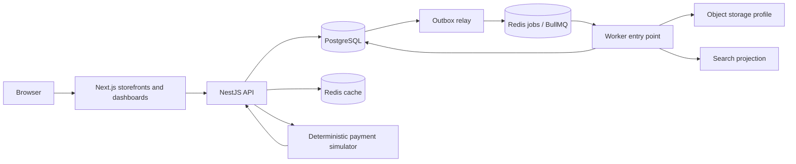

# ShopScale architecture

Status: proposed implementation architecture. The user selected the product model and TypeScript/NestJS/Next.js; other choices are proposed ADRs. No runtime is implemented yet.

## System shape

A modular monolith with independently runnable API and worker entry points, one PostgreSQL database, and one Next.js application. Keep domain modules in packages/backend so API and worker reuse the same business logic rather than importing each other's applications.



Browser requests go through a same-origin web gateway; business rules and authorization remain in NestJS. Server-rendered public content can call Nest directly. The gateway forwards only documented headers and never trusts a browser-supplied actor or store scope.

## Boundaries

- Platform owns configuration, transaction infrastructure, and the AuditWriter port; reporting reads audit records without creating reverse module dependencies.
- Identity owns users, sessions, and authentication.
- Stores owns business/store membership, approval, theme, and channel resolution.
- Catalog owns products, variants, prices, publication, and media references.
- Inventory owns stock invariants and reservations.
- Commerce owns checkout orchestration, orders, seller suborders, fulfillment, returns, and refund requests.
- Payments owns mock provider operations, webhook receipts, financial effects, and reconciliation.
- Search, notifications, reporting, and review aggregates consume durable events.
- API and worker composition roots wire application ports. Modules export interfaces/services, not unrestricted repositories.

[Capability map](docs/architecture/module-map.md) is the module index. [Data model](docs/architecture/data-model.md), [API contracts](docs/architecture/api-contracts.md), and [event contracts](docs/architecture/events.md) are canonical.

## Core correctness rules

1. Derive actor from a verified session; derive store/channel from trusted route resolution. Never authorize by an arbitrary store_id in a request body.
2. Checkout snapshots prices, product text, addresses, shipping, and discounts. Historical orders never read live prices to recalculate paid totals.
3. Reserve all basket lines in one transaction, locking variants in stable ID order. Network calls never occur while inventory row locks are held.
4. Store order, reservation, coupon hold, idempotency outcome, and outbox events atomically.
5. Make provider calls with durable effect keys. Persist observation and reconcile uncertainty instead of blindly charging again.
6. Accept that jobs and webhooks repeat. Internal dedupe and business writes share one database transaction; external effects need provider idempotency or a durable delivery ledger.
7. Shared customer accounts do not grant store staff access to global customer profiles or other sellers' order lines.
8. Public channel caches include channel, store, locale, and publication version. Private pages and personalized responses are never shared-cache content.

## Proposed stack

| Concern | Choice | Why here |
| --- | --- | --- |
| Backend | NestJS + Fastify + TypeScript | Familiar stack, explicit module interfaces |
| Frontend | Next.js App Router + React + TypeScript | Server-rendered catalog, small interactive client boundaries |
| Database | PostgreSQL; Drizzle + node-postgres | Inspectable relational schema and explicit SQL on hot paths |
| Jobs | BullMQ with separate Redis jobs instance | Reuses familiar Redis operations without early RabbitMQ overhead |
| Search | PostgreSQL FTS + pg_trgm + event-built projection | Fits local constraints while supporting typo matching |
| UI | CSS variables/CSS Modules; accessible primitive components | Direct mapping to existing design tokens |
| Tests | Jest backend, Vitest/Testing Library frontend, Playwright E2E, k6 load | Match verification to the behavior being proved |
| Telemetry | Structured JSON from start; OpenTelemetry and Prometheus profiles later | Observe failures without always running every dashboard |

Exact supported versions must be checked and pinned in T002. PostgreSQL 16 and Redis 7 are source-PRD baselines, not claims of current latest releases.

## Intended repository layout

```text
apps/api/             HTTP composition root
apps/worker/          relay, schedulers, consumers
apps/web/             Next.js routes, UI, same-origin gateway
apps/mock-payments/   signed deterministic provider simulator
packages/backend/    Nest domain modules and application ports
packages/contracts/  public API/event schemas; no ORM model leakage
packages/config/     shared checked configuration
db/migrations/       reviewed SQL generated/authored with Drizzle
db/seed/             deterministic tiers and verification
tests/integration/   real PostgreSQL and Redis tests
tests/e2e/           browser journeys and accessibility
loadtests/           k6 scenarios and raw results
infra/               Compose profiles and telemetry configuration
docs/                specifications, ADRs, operations, learning
tasks/               roadmap, task index, individual task files
skills/              unchanged downloaded references; excluded from app globs
```

## First bottleneck and scaling path

Expect database contention on popular variants and expensive search/filter queries before a need for microservices. Measure lock waits, query plans, and pool saturation; improve indexes, query shape, and concurrency limits first. Add worker replicas, search infrastructure, and read replicas only with a measured reason.

## Primary references

Nest encapsulates providers through module exports: [Nest modules](https://docs.nestjs.com/modules). Next documents the server/client component boundary: [Next.js component guide](https://nextjs.org/docs/app/getting-started/server-and-client-components). Those capabilities inform this proposal; they do not prove this implementation's behavior.
