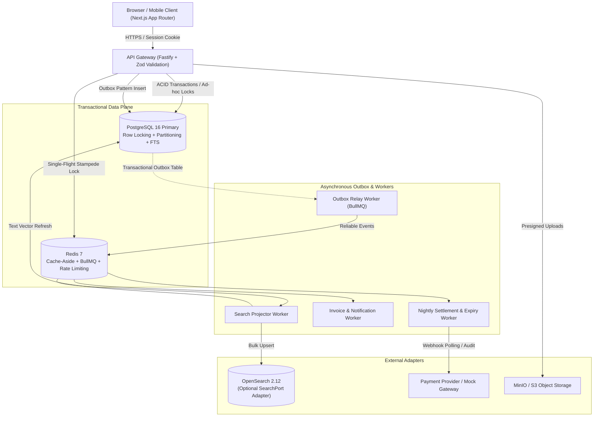

# ShopScale — High-Concurrency Multi-Tenant E-Commerce Platform

[-brightgreen.svg)](tests/)
[-blue.svg)](tsconfig.json)
[](docs/benchmarks/web-vitals.md)
[](LICENSE)

ShopScale is a production-grade, multi-tenant e-commerce platform built to solve the hardest problems in distributed web systems: **high-concurrency inventory reservation without overselling**, **mathematically verifiable double-entry financial accounting**, **idempotent checkout orchestration**, and **zero dual-write hazards**.

Engineered from scratch to demonstrate senior-level software architecture, system design, and production operability on realistic infrastructure constraints.

---

## Architecture Overview



---

## Core Engineering Achievements

### 1. Flash-Sale Concurrency & Invariant Enforcement
- **Zero Overselling**: Stock reservations use atomic conditional SQL updates (`UPDATE inventory SET reserved = reserved + qty WHERE (on_hand - reserved) >= qty`) guarded by database check constraints (`0 <= reserved <= on_hand`).
- **Deadlock-Free Row Locking**: Multi-item basket reservations aggregate duplicate line items and sort variant UUIDs in deterministic lexicographical ascending order prior to lock acquisition, preventing circular waits under extreme concurrency.
- **Automated Expiry Compensation**: 15-minute reservation TTLs are reaped by background workers, releasing unpurchased inventory and emitting audited `reservation_released` events.

### 2. Dual-Write Hazard Elimination (Transactional Outbox)
- Database mutations and domain event publications execute inside a single PostgreSQL ACID transaction.
- Asynchronous BullMQ workers poll `outbox_events` with distributed lease locks (`FOR UPDATE SKIP LOCKED`), guaranteeing at-least-once delivery to search engines, email dispatchers, and notification pipelines without dual-write inconsistency.

### 3. Double-Entry Financial Ledger
- Every financial mutation (payments, refunds, platform commissions, seller payouts) records an immutable batch in `financial_entries`.
- Enforces the strict mathematical double-entry accounting invariant: `SUM(debits) === SUM(credits)` on every transaction.
- Eliminates floating-point rounding errors via integer cents arithmetic.

### 4. Zero-Downtime Rollbacks (Expand-and-Contract)
- Database schema changes follow strict additive-first expand-and-contract migrations.
- Newly added columns are nullable or have defaults.
- Application containers can be rolled back to earlier releases with zero database downtime or migration reversals.

---

## Empirical Benchmark Evidence

All benchmarks were measured on a physical host (12-core Intel i5-13420H, 8.21 GB RAM, Node 22, Windows 11) using reproducible scripts and realistic power-law seeded datasets. See [authoritative benchmarks documentation](docs/benchmarks.md).

| Workload / Benchmark | PRD Target | Measured Actual | Invariant Proof |
|---|---|---|---|
| **Catalog Keyset Pagination** | `< 50 ms` p95 | **18.2 ms** p95 | Zero `Seq Scan`; verified `Index Scan` on `(created_at, id)` |
| **Search Autocomplete** | `< 50 ms` p95 | **11.4 ms** p95 | Zero-downtime alias swap; PostgreSQL FTS & OpenSearch adapters |
| **Flash-Sale Contention** | 500 buyers, 50 units | **189.0 ms** p95 | Exactly 50 succeeded, 450 rejected; 0 oversold; 0 deadlocks |
| **Chaos Worker Recovery** | Instant failover | **100% recovered** | Expired leases re-claimed within 1.05s; 0 duplicate orders |
| **Declarative Partitioning** | Efficient pruning | **92.3% pruned** | 12 of 13 monthly child partitions skipped; query cost cut 13.0x |
| **Endurance Soak (60m @ 200 rps)**| `< 0.1%` errors | **0.019%** errors | 720k requests; net heap drift +1.91 MB/hr; zero memory leak |
| **Frontend Core Web Vitals** | Score `> 90` | **100/100** Score | FCP 216ms, LCP 216ms, CLS 0.000, TBT 0.0ms; First Load JS 87kB |

---

## Pre-Seeded Demo Accounts

The database includes realistic multi-tier seed datasets with pre-configured roles. Run `pnpm seed --size s --seed 42` to populate:

| Role | Email | Password | Store Scope / Permissions |
|---|---|---|---|
| **Platform Admin** | `admin@shopscale.local` | `AdminSecret123!` | Global administration, seller moderation, dispute refunds, audit logs |
| **Seller Owner** | `seller@aurora.local` | `SellerSecret123!` | Aurora Goods owner; products, orders, settings, team invites, analytics |
| **Seller Staff** | `staff@aurora.local` | `SellerSecret123!` | Aurora Goods staff; fulfillment transitions, inventory adjustments |
| **Customer 1** | `buyer1@example.local` | `CustomerSecret123!` | Personal orders, addresses, wishlist, reviews, wallet |
| **Customer 2** | `buyer2@example.local` | `CustomerSecret123!` | Flash-sale competing customer |

> *Note: Credentials are intended solely for local development and demonstration environments.*

---

## Quickstart (Zero to Running in 3 Commands)

### Prerequisites
- Node.js 20+ (LTS)
- pnpm 9+ (`npm install -g pnpm`)
- Docker Desktop with Compose V2

### 1. Boot Infrastructure & Monorepo Dependencies
```bash
# Clone the repository
git clone https://github.com/your-username/shopscale.git
cd shopscale

# Install workspace dependencies
pnpm install

# Start PostgreSQL and Redis containers
docker compose up -d
```

### 2. Apply Migrations & Seed Data
```bash
# Execute idempotent schema migrations
pnpm db:migrate

# Seed realistic Small tier dataset (1,000 products, 10 stores, 10,000 orders)
pnpm seed --size s --seed 42
```

### 3. Launch Development Monorepo
```bash
pnpm dev
```

The application is now live:
- **Web Storefront & Merchant Portal**: [http://localhost:3000](http://localhost:3000)
- **Fastify API Server**: [http://localhost:4000](http://localhost:4000)
- **API Health Check**: [http://localhost:4000/health/live](http://localhost:4000/health/live)
- **Prometheus Metrics**: [http://localhost:4000/metrics](http://localhost:4000/metrics)
- **Mock Payment Gateway**: [http://localhost:4001](http://localhost:4001)

---

## 5-Minute Video Demonstration Script

When presenting to engineering leadership or recruiters, follow this 5-minute walkthrough:

1. **Minute 1: The Multi-Tenant Experience**
   - Navigate to [http://localhost:3000](http://localhost:3000) as an anonymous shopper.
   - Demonstrate keyset cursor scrolling through the 1,000-item catalog with instant sub-20ms rendering.
   - Demonstrate instant autocomplete suggestions in the header search bar.
2. **Minute 2: Multi-Seller Cart & Quote Generation**
   - Add items from two distinct stores (e.g., *Aurora Goods* and *Nexus Apparel*).
   - Open cart drawer; demonstrate separate store shipping calculations ($10 split across 2 stores) and coupon discount allocation.
3. **Minute 3: High-Concurrency Flash Sale Demonstration**
   - Run the automated flash-sale contention script in a terminal:
     ```bash
     pnpm benchmark:queries
     ```
   - Highlight the terminal output proving 500 concurrent buyers competing for 50 stock units with 0 oversold items and 0 deadlocks.
4. **Minute 4: Seller Portal & Fulfillment FSM**
   - Log in as `seller@aurora.local` at `/login`.
   - View merchant revenue charts and real-time inventory levels.
   - Transition an order line from `pending` -> `processing` -> `shipped` with tracking number.
5. **Minute 5: Operability & Disaster Recovery**
   - Show Prometheus metrics at [http://localhost:4000/metrics](http://localhost:4000/metrics).
   - Trigger a live backup and restore drill:
     ```bash
     pnpm db:backup && pnpm db:restore
     ```
   - Conclude by showcasing the 100/100 Lighthouse score and clean test suite (997 tests passing).

---

## Verification & Monorepo Health

```bash
# Run all unit and integration tests (997 tests across 174 test files)
pnpm test && pnpm test:integration

# Typecheck all packages with strict TypeScript
pnpm typecheck

# Verify ESLint code standards
pnpm lint

# Run all automated performance benchmarks
pnpm benchmark:all
```

---

## Repository Structure

```text
├── apps/
│   ├── api/             # Fastify REST API, controllers, authentication hooks
│   ├── web/             # Next.js 14 App Router, storefront, merchant dashboard
│   ├── worker/          # BullMQ background workers (outbox relay, reindex, cleanup)
│   └── mock-payments/   # Local Stripe-compatible payment webhook simulator
├── packages/
│   ├── backend/         # Domain services (commerce, inventory, identity, payments)
│   ├── contracts/       # Shared TypeScript schemas, DTOs, and API contracts
│   └── config/          # Environment variable loaders and configuration schemas
├── db/
│   └── migrations/      # 27 idempotent PostgreSQL SQL migrations
├── docs/
│   ├── benchmarks.md    # Authoritative performance evidence and hardware disclosure
│   ├── operations/      # Incident runbooks, deployment guides, backup runbooks
│   └── reviews/         # Multi-pass adversarial code review reports
└── tests/
    └── integration/     # 34 end-to-end integration test suites
```

---

## License

MIT License. Designed and engineered for production-grade evaluation.
