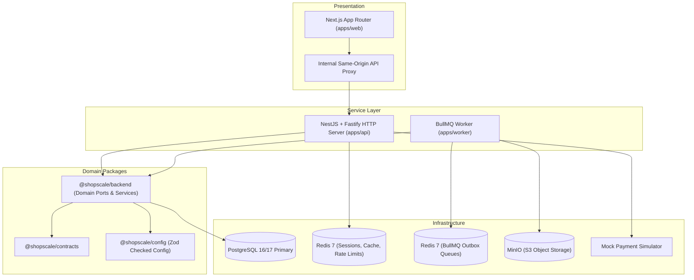

# Canonical Architecture Specification: ShopScale

> **Authoritative Technical Blueprint and System Conventions**  
> Every implementation task references this document; no task may invent diverging architectural patterns.

---

## 1. Architectural Style & Boundaries

ShopScale is architected as a **modular monolith** with independently runnable HTTP and asynchronous worker entry points. This architectural style provides strong domain isolation without the operational complexity, distributed transactions, and network latency of microservices.



### 1.1 Module Boundaries & Single Responsibilities
Domain code resides in `packages/backend/src/` divided into decoupled modules communicating via exported **application ports**:
1. **`platform`**: Cross-cutting database transaction port (`UnitOfWorkContext`), outbox writer, audit logging port, and security helpers.
2. **`identity`**: User accounts, Argon2id password hashing, session families, refresh token rotation, and email verification.
3. **`stores`**: Multi-tenant business entities, store metadata, staff memberships, role permissions, and channel resolution.
4. **`catalog`**: Categories, products, variants, price cents, attributes JSONB, and per-channel publication flags.
5. **`inventory`**: Stock invariants (`on_hand`, `reserved`), atomic basket reservations, expiry schedules, and append-only stock movement ledger.
6. **`cart`**: Channel-scoped carts (marketplace basket vs. store baskets), item management, and guest-to-customer cart merge.
7. **`commerce`**: Checkout orchestration, quote calculations, parent orders, immediate seller suborders, order lifecycle state machine, and after-sales returns.
8. **`payments`**: Idempotent payment attempts, effect key tracking, signed HMAC webhook receipts, refund processing, and double-entry financial ledger.
9. **`promotions`**: Coupon validation, usage limits, and proportional basket allocation.
10. **`search`**: Event-projected search documents, PostgreSQL full-text/trigram indices, facets, and instant autocomplete.
11. **`engagement`**: Verified purchaser product reviews, async rating aggregation, and customer wishlists.
12. **`notifications`**: Transactional email/SMS event consumers, rendering, and dead-letter queue retries.
13. **`reporting`**: Materialized sales views, seller analytics, and platform administrative metrics.
14. **`operations`**: Distributed tracing, Prometheus metrics collection, health endpoints, and chaos recovery.

---

## 2. Frontend / Backend Boundaries

1. **Next.js App Router (`apps/web`)**:
   - Server Components render catalog pages (Home, Category, PDP) directly to HTML with zero client JavaScript overhead for static reading.
   - Client Component islands (`'use client'`) are strictly confined to interactive boundaries: Add-to-Cart buttons, Cart Drawer, Checkout Form, and Seller Console Editors.
   - The same-origin Next.js server proxy (`/api/proxy/...`) forwards authenticated requests to the NestJS API, forwarding the HTTP-only session cookie.
2. **NestJS API (`apps/api`)**:
   - Owns all business logic, authorization checks, and database mutations.
   - The browser **never** talks directly to raw seller or admin write routes without passing through the authenticated session gateway.
   - Returns standard RFC 7807 problem details error envelopes.

---

## 3. Data Ownership & Transaction Management

1. **Strict Table Ownership**: Each module owns its designated database tables. Direct foreign-table writes are strictly forbidden. Cross-module data modifications must occur through exported service ports.
2. **Single Unit-of-Work Context**: When a business operation spans multiple modules (e.g., checkout modifying carts, reserving inventory, and creating an order), the coordinator passes a single Drizzle transaction context (`tx: UnitOfWorkContext`) through the module ports.
3. **Zero Distributed Transactions**: Business writes and outbox event persistence commit inside the **exact same PostgreSQL transaction**.
4. **Deadlock-Free Locking Order**: Any operation locking multiple rows (especially inventory variants or order items) MUST sort target IDs in ascending order before acquiring row-level locks:
   ```sql
   SELECT * FROM inventory WHERE variant_id = ANY($1) ORDER BY variant_id ASC FOR UPDATE;
   ```
5. **No Network Calls Under Lock**: HTTP requests to payment gateways, notification dispatches, or object storage uploads are **never executed while holding database transaction locks**.

---

## 4. Synchronous vs. Asynchronous Operations

| Operation Type | Mode | Mechanism | Rationale |
|---|---|---|---|
| **Stock Reservation** | Synchronous | In-transaction row lock | Prevents overselling; client needs immediate confirmation. |
| **Payment Authorization** | Synchronous | HTTP to Payment Provider | Customer waits on checkout screen for card approval. |
| **Order Record Creation** | Synchronous | DB transaction | Must record order before charging payment. |
| **Outbox Event Persistence**| Synchronous | DB transaction with order | Guarantees zero event loss on system crash. |
| **Search Document Projection**| Asynchronous | BullMQ Worker | Search latency does not block catalog write operations. |
| **Email / SMS Notifications** | Asynchronous | BullMQ Worker + DLQ | Third-party messaging retries do not slow user checkout. |
| **PDF Invoice Generation** | Asynchronous | BullMQ Worker + MinIO | Heavy CPU rendering offloaded from request thread. |
| **Reservation Expiry** | Asynchronous | Scheduled BullMQ Job | Periodic cleanup of abandoned checkout baskets. |

---

## 5. API Conventions & Standards

- **Base Path**: All business endpoints are versioned under `/v1/` (e.g., `/v1/catalog/products`).
- **Health & Ops**: Unversioned at `/health/live`, `/health/ready`, and `/metrics`.
- **Identifiers**: UUID v4 for all primary entities.
- **Monetary Values**: Integers representing cents (`1050` = $10.50). Serialized as decimal strings at JSON boundaries (`"1050"`) to avoid JavaScript floating-point truncation.
- **Pagination**: Keyset (cursor-based) pagination across all high-volume endpoints:
  - Request: `?limit=20&cursor=eyJjcmVhdGVkQXQiOiIyMDI2LTExLTE2...`
  - Response: `{ items: [...], nextCursor: "..." | null }`
- **Error Format (RFC 7807)**:
  ```json
  {
    "type": "https://shopscale.dev/errors/insufficient-stock",
    "title": "Insufficient Stock",
    "status": 409,
    "detail": "Requested 5 units of variant 'var_123', but only 2 units are available.",
    "code": "INSUFFICIENT_STOCK",
    "instance": "/v1/checkout",
    "requestId": "req_abc123"
  }
  ```
- **HTTP Status Codes**:
  - `200 OK`: Successful synchronous read or update.
  - `201 Created`: Successful creation with entity returned.
  - `202 Accepted`: Asynchronous operation accepted for background processing.
  - `400 Bad Request`: Malformed payload, invalid syntax, or invalid cursor.
  - `401 Unauthorized`: Missing or invalid authentication token.
  - `403 Forbidden`: Authenticated user lacks permission.
  - `404 Not Found`: Entity does not exist OR user lacks tenancy access (uniform 404 rule).
  - `409 Conflict`: Stale version conflict, idempotency key replay mismatch, or stock exhausted.
  - `422 Unprocessable`: Schema validation failure.
  - `429 Too Many Requests`: Rate limit exceeded (includes `Retry-After` header).
  - `500 Internal Error`: Unexpected server failure (redacted in production).

---

## 6. Database Schema & Migration Strategy

- **Database Engine**: PostgreSQL 16 (production baseline) / PostgreSQL 17 (tested locally).
- **ORM & Querying**: Drizzle ORM for schema definitions and typed relational queries; raw parameterized SQL via `node-postgres` on high-concurrency hot paths (e.g., inventory reservation updates, keyset cursor pagination, and outbox relay polling).
- **Migrations**:
  - Sequential SQL migrations located in `db/migrations/` (`0000-bootstrap.sql`, `0001-identity.sql`, ...).
  - Executed via `pnpm db:migrate` using a migration table lock.
  - **Additive-First Rule**: Breaking schema changes require two phases: (1) add new column nullable, backfill data, update writers; (2) switch readers, retire old column in later release.
- **Referential Integrity**:
  - Foreign keys default to `ON DELETE RESTRICT` for orders, financial ledgers, and catalog history to prevent accidental data destruction.
  - Composite foreign keys `(store_id, resource_id)` enforce multi-tenant isolation at the database layer.

---

## 7. Caching Strategy & Stampede Protection

- **Cache Engine**: Redis 7.
- **Keyspace Partitioning**:
  - Cache: Database index 0.
  - Rate Limiting / Ephemeral Sessions: Database index 1.
  - BullMQ Queues: Separate dedicated Redis instance (or DB 2 with `noeviction` policy).
- **Cached Entities**:
  - Product Detail Pages: `cache:pdp:{storeSlug}:{productSlug}` (TTL 5 minutes).
  - Store Themes: `cache:theme:{storeSlug}` (TTL 1 hour).
  - Category Hierarchy: `cache:categories:tree` (TTL 24 hours).
- **Cache-Aside Pattern with Single-Flight Mutex**:
  When a cache miss occurs on hot items, a Redis distributed lock (`SET lock:{key} 1 EX 5 NX`) ensures only **one** process queries PostgreSQL, while concurrent requests wait with exponential backoff or receive stale cached content (`stale-while-revalidate`).
- **Event-Driven Invalidation**:
  When catalog items mutate, `ProductChanged` events emitted to the outbox trigger immediate cache key invalidation before the next read.

---

## 8. Authentication & Authorization Architecture

- **Password Security**: Argon2id with memory cost 64MB, time cost 3, parallelism 4.
- **Session Architecture**:
  - Short-lived JWT access tokens (15 minutes).
  - Long-lived session records stored in PostgreSQL (`session_families`).
  - Rotating refresh tokens (7 days) stored as SHA-256 hashes.
  - **Reuse Detection**: If an already-used refresh token is presented, the entire session family is instantly revoked, mitigating stolen token replays.
- **Transport**: Stored in `HttpOnly`, `SameSite=Lax`, `Secure` cookies with double-submit CSRF protection on mutating requests.
- **Authorization Enforcement**:
  - **Platform RBAC**: Guards enforce platform permissions (`platform_roles`: `admin`, `support`, `customer`).
  - **Multi-Tenant ABAC**: Seller operations enforce `store_id` matching from session membership (`store_roles`: `owner`, `manager`, `catalog-editor`, `fulfillment`).
  - **Uniform 404 Rule**: Any request to `/v1/seller/stores/{id}/...` where `{id}` is not part of the actor's verified store membership returns `404 Not Found` (never `403 Forbidden`) to prevent store existence probing.

---

## 9. Observability, Logging & Telemetry

- **Structured Logging**: Pino structured JSON logger with standard fields: `timestamp`, `level`, `requestId`, `userId`, `storeId`, `module`, and `message`.
- **Sensitive Data Redaction**: Automatic redaction of `password`, `token`, `secret`, `authorization`, `creditCard`, and customer PII.
- **Metrics**: Prometheus metrics exposed at `/metrics` tracking:
  - HTTP request duration histogram (`http_request_duration_seconds{route, method, status}`).
  - Active checkout reservations gauge (`checkout_reservations_active`).
  - Outbox queue lag and oldest unconsumed event age (`outbox_lag_seconds`).
  - Database connection pool saturation (`pg_pool_active_connections`).
- **Distributed Tracing**: OpenTelemetry SDK injecting W3C `traceparent` headers across HTTP requests, transactional outbox relays, and BullMQ worker jobs.

---

## 10. Environments & Scaling Strategy

- **Development**: Docker Compose (`compose.yml`) running PostgreSQL 16, Redis 7, and MinIO with host Node.js processes for Fastify and Next.js.
- **Staging / Test**: Ephemeral PostgreSQL containers via Testcontainers for integration tests.
- **Scaling Path**:
  1. *Step 1 (First Bottleneck)*: Hot variant lock contention during sales -> Mitigate with keyset indexes, connection pooling (PgBouncer), and Redis Lua rate limiting.
  2. *Step 2*: Read-heavy search traffic -> Scale out Next.js server instances; route read traffic to PostgreSQL read replicas.
  3. *Step 3*: Massive catalog (>1M products) -> Migrate search projection from PostgreSQL `search_documents` to dedicated OpenSearch cluster without altering application contracts.
