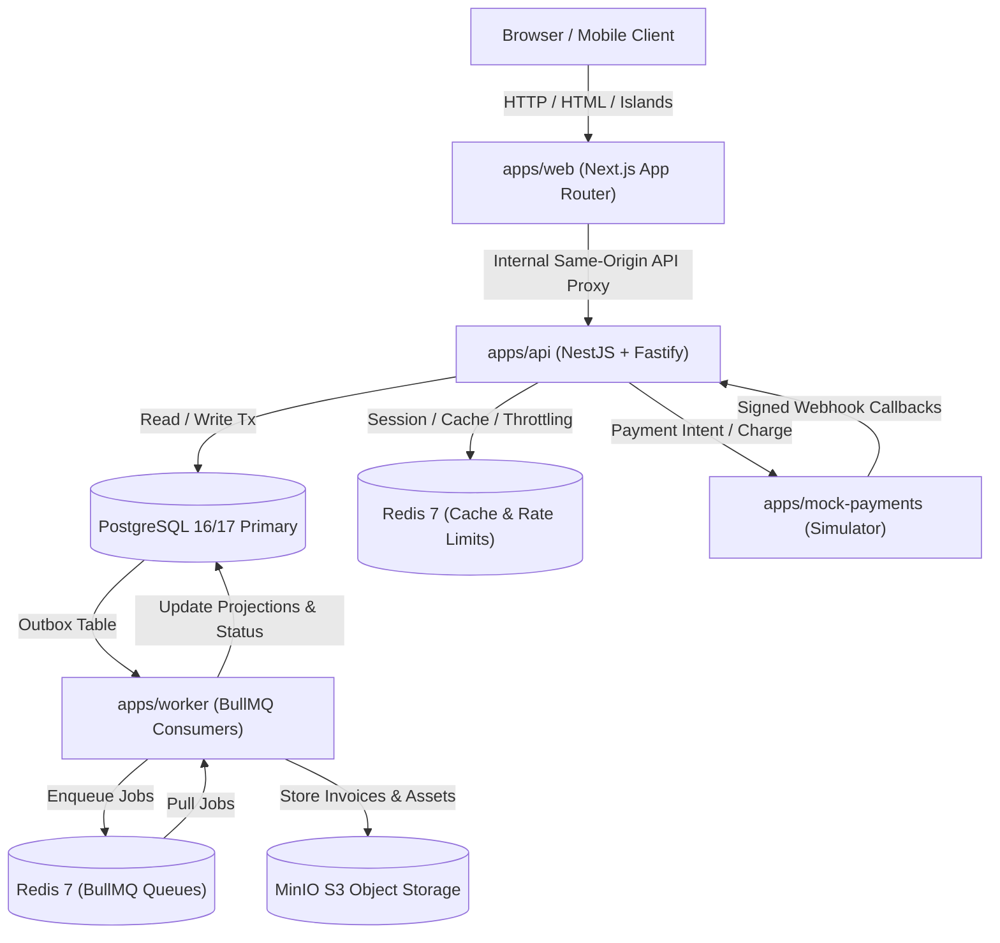

# Master Implementation Plan: ShopScale Multi-Vendor E-commerce Marketplace

> **Authoritative Technical Roadmap and Engineering Execution Plan**  
> Covers PRD requirements, architecture, dependency critical path, and release gates.

---

## 1. Project Summary

### 1.1 What Is Being Built
**ShopScale** is a portfolio-grade, high-concurrency multi-vendor e-commerce marketplace and branded multi-store platform. It demonstrates production-level engineering rigor: handling high traffic, avoiding overselling under extreme concurrency, executing safe and idempotent payments, enforcing multi-tenant isolation, surviving asynchronous worker crashes without lost side effects, and maintaining observable sub-150ms catalog performance across a 100,000-product dataset.

### 1.2 Target Users and Personas
1. **Guests**: Anonymous visitors browsing channels, searching products, viewing product details, and maintaining temporary carts.
2. **Customers**: Authenticated buyers managing channel-scoped carts, saving shipping addresses, executing idempotent checkout, viewing order histories, managing wishlists, initiating return requests, and writing verified-purchaser product reviews.
3. **Sellers (Vendors & Store Staff)**: Independent merchants owning branded stores (`/stores/{slug}`) and selling on the shared marketplace (`/`). Store staff roles include `owner`, `manager`, `catalog-editor`, and `fulfillment`, each restricted by fine-grained permissions and tenancy scopes.
4. **Support Agents**: Platform operational staff inspecting orders, customer inquiries, and issuing discretionary refunds up to a configured policy cap (seeded as $200 / 20,000 cents).
5. **Platform Administrators**: Superusers approving seller applications, configuring category trees, reviewing audit logs, monitoring GMV/order health, and tuning platform policy settings.

### 1.3 What V1 Must Accomplish
V1 delivers a rock-solid, fully testable, end-to-end multi-store commerce lifecycle:
- High-performance catalog browsing and search projection with cursor pagination and facet filtering.
- Multi-channel cart isolation (marketplace basket vs. store baskets).
- Atomic inventory reservation preventing overselling when 500 concurrent buyers compete for 50 stock units.
- Idempotent multi-seller checkout splitting immediate seller suborders.
- Deterministic mock payment gateway with signed HMAC webhook callbacks, reconciliation, and automated compensation sagas.
- Independent seller fulfillment workflows, partial returns, and double-entry financial ledgers.
- Comprehensive authorization harness verifying every route against every role.
- Transparent benchmark suite verifying p95 latency SLOs and database query plans on seeded datasets up to Tier L (100k products).

---

## 2. Sources Analyzed

The implementation plan is derived directly from the authoritative repository sources:
1. `01-ecommerce-marketplace-PRD.md`: Master product requirements document (Goals G1–G6, requirements ID-1..5, CT-1..7, IN-1..5, CA-1..3, OR-1..9, RV-1..2, AD-1..4, volume tiers S/M/L/XL, and SLOs).
2. `PRD_TO_TASKS_FRAMEWORK.md`: Engineering operating manual, Phase -1 through Phase 5 pipeline, git branch lifecycle, review requirements, and TDD loop.
3. `ARCHITECTURE.md` (root): System shape, modular monolith boundaries, core correctness rules, and component topology.
4. `design.md`: Visual tokens, layout structure, responsive rules, store themes, and accessibility baselines.
5. `docs/architecture/*`:
   - `conventions.md`: Money in bigint cents, naming, error envelope RFC 7807, transaction boundaries.
   - `data-model.md`: Logical relational schema, composite keys, RESTRICT constraints, and index strategy.
   - `api-contracts.md`: REST API shapes under `/v1/`, OpenAPI 3.1 generator, and error contracts.
   - `events.md`: Transactional outbox envelope, idempotent consumers, receipt tracking, and BullMQ queues.
   - `module-map.md`: Acyclic capability map and module dependencies.
   - `frontend.md`: Next.js App Router presentation architecture and client island boundaries.
6. `docs/decisions/*`: Architectural Decision Records ADR-0001 through ADR-0010.
7. `docs/planning/*`: `scope.md`, `requirements-reconciliation.md`, `traceability.md`, `risk-register.md`.
8. `skills/`: Project skill ecosystem in `agent-skills-main`, `reticle-main`, and `skills-main`.
9. Existing code: 122 backend tests, 173 web tests, 7 database migrations, and 29 completed tasks.

---

## 3. Scope Specification

### 3.1 In-Scope for V1 (Portfolio Demo Baseline)
- **Monorepo Architecture**: Fastify/NestJS API, Next.js App Router storefront/console, BullMQ background worker, PostgreSQL 16/17, Redis 7.
- **Identity & Tenancy**: Global customer account, Argon2id passwords, session families, rotating refresh tokens with reuse revocation, rate limiting, and scoped store memberships (`owner`, `manager`, `catalog-editor`, `fulfillment`).
- **Storefronts & Catalog**: Marketplace (`/`), branded store storefronts (`/stores/{slug}`), token-based theming, category hierarchy, variants, and keyset cursor pagination.
- **Discovery**: Full-text and trigram search projection in PostgreSQL (`search_documents`), autocomplete under 50ms, facet counts, and cache-aside with single-flight mutex.
- **Inventory & Carts**: On-hand and reserved counters, atomic conditional decrements, 15-minute reservation TTL with expiry worker, append-only stock movement ledger, channel-scoped carts, and guest cart login merge.
- **Checkout & Payments**: Quote generation with price guarantees, idempotent checkout with `Idempotency-Key`, parent order creation with immediate seller suborder splitting, deterministic mock payment simulator, HMAC-SHA256 signed webhooks, deduplication, and compensation saga (refund/void on stock expiry).
- **Fulfillment & Post-Order**: Independent seller fulfillment state machine (`PENDING -> PAID -> PACKED -> SHIPPED -> DELIVERED`), customer order history, cancellation of unshipped lines, return requests with inspection workflow, partial refunds, balanced double-entry financial ledger, and local PDF invoice generation.
- **Reviews & Engagement**: Verified purchaser review enforcement (one review per user per product), async aggregate rating calculation, and customer wishlists.
- **Audit & Admin**: Append-only privileged mutation audit logging, platform dashboard, seller analytics views, and support refund limits.
- **Reliability & Benchmarking**: Distributed request tracing, Prometheus metrics, broker crash/recovery verification, realistic seed tiers (S, M, L), k6 load scenarios (concurrency, browse mix, search stress), and EXPLAIN ANALYZE query plan evidence.

### 3.2 Explicitly Deferred Scope (V1.1 / Production Roadmap)
- Real payment processing (Stripe / Adyen / PayPal live integrations; mock provider used for V1).
- Live shipping carrier APIs (FedEx, UPS, DHL; simulated status transitions used for V1).
- OpenSearch as mandatory primary engine (PostgreSQL search projection is primary for V1; OpenSearch is an optional comparison profile in T081).
- Real SMS / external email delivery (local demo notification adapters used for V1).
- Raw SVG upload parsing and execution (raster formats JPG, PNG, WebP supported in V1; SVG deferred pending security sanitizer in T035).
- Machine learning recommendations or personalization.
- Multi-currency conversion and international tax compliance (all monetary values modeled in USD cents).

### 3.3 Out of Scope
- Native mobile applications (iOS/Android).
- Store ownership transfer workflows.
- Multiple stores per business.
- Digital goods, software licenses, or subscription billing.
- Direct customer account deletion / GDPR hard-purge (account deactivation/suspension is supported).

---

## 4. Requirements Traceability Summary

Every requirement from the PRD maps to an explicit task and verification gate:

| Module Domain | Requirement IDs | Total | Implemented | Planned | Primary Tasks |
|---|---|---|---|---|---|
| **Identity & Access** | `ID-1` to `ID-5`, `REQ-STORE-001..003` | 8 | 8 | 0 | `TASK-009`–`TASK-018`, `TASK-091` |
| **Catalog & Search** | `CT-1` to `CT-7` | 7 | 2 | 5 | `TASK-019`–`TASK-028`, `TASK-029`–`TASK-036` |
| **Inventory** | `IN-1` to `IN-5` | 5 | 0 | 5 | `TASK-037`–`TASK-040`, `TASK-044`, `TASK-076` |
| **Cart** | `CA-1` to `CA-3` | 3 | 0 | 3 | `TASK-041`–`TASK-043` |
| **Checkout & Orders** | `OR-1` to `OR-9` | 9 | 0 | 9 | `TASK-045`–`TASK-054`, `TASK-056`, `TASK-060`, `TASK-061`, `TASK-063` |
| **Reviews & Social** | `RV-1`, `RV-2`, `REQ-WISH-001` | 3 | 0 | 3 | `TASK-064`, `TASK-065` |
| **Admin & Audit** | `AD-1` to `AD-4` | 4 | 0 | 4 | `TASK-062`, `TASK-066`, `TASK-067`, `TASK-069`, `TASK-076` |
| **Non-Functional (SLOs)** | `G1` to `G6`, `NFR-001..012` | 18 | 6 | 12 | `TASK-071`–`TASK-084` |

*See [REQUIREMENT_TRACEABILITY.md](REQUIREMENT_TRACEABILITY.md) for the complete, row-by-row matrix.*

---

## 5. Architecture Summary

### 5.1 System Shape & Topology
ShopScale is structured as a **modular monolith** with decoupled entry points sharing domain logic:
- `apps/api`: HTTP composition root powered by Fastify and NestJS. Exposes REST endpoints under `/v1/`, enforces authentication guards, tenancy context, and input validation schemas.
- `apps/worker`: Asynchronous background processor powered by BullMQ on Redis. Runs outbox relay polling (`FOR UPDATE SKIP LOCKED`), search projection consumers, invoice PDF generation, notification delivery, and inventory reservation expiry jobs.
- `apps/web`: Next.js App Router application. Renders public catalog pages on the server (SSR), hosts React client islands for interactive carts and checkout, and provides the seller/admin management console.
- `apps/mock-payments`: Standalone or co-located HTTP service simulating external payment authorization, webhooks, and network timeouts with deterministic responses.
- `packages/backend`: Pure business domain modules (`identity`, `stores`, `catalog`, `inventory`, `cart`, `commerce`, `payments`, `promotions`, `search`, `engagement`, `reporting`, `platform`). Communicates exclusively through typed application ports.
- `packages/contracts`: Shared TypeScript interfaces, DTOs, and Zod schemas for all public API requests, responses, and domain events.
- `packages/config`: Centralized, Zod-validated environment configuration loaded at process boot.



### 5.2 Core Correctness Invariants
1. **No Distributed Transactions**: Business writes and outbox event persistence share **one single PostgreSQL database transaction**.
2. **Deterministic Locking Order**: When reserving, confirming, or releasing inventory, variant locks are acquired in strictly ascending variant ID order (`ORDER BY variant_id ASC FOR UPDATE`) to prevent deadlocks under high concurrency.
3. **Network Isolation from DB Locks**: Remote network calls (payment simulator, external webhooks, email dispatch) are **never executed while holding database row locks**.
4. **Tenancy and Resource Boundary**: Staff access is evaluated against `(user_id, store_id)`. Any attempt to access a resource belonging to another store results in a uniform `404 Not Found` to eliminate security oracles.
5. **Double-Entry Financial Accounting**: Every monetary balance change (orders, refunds, simulated seller payouts) is recorded in an append-only `financial_entries` ledger where debits equal credits.

---

## 6. Implementation Phases


### Phase 0: Foundation (`TASK-001` – `TASK-008`) — [COMPLETED]
- Established pnpm monorepo workspace, TypeScript configs, ESLint rules, and Vitest harnesses.
- Configured Drizzle ORM with zero-downtime migration runner (`db/migrations/`).
- Designed minimal Docker Compose profiles for PostgreSQL 16/17 and Redis 7.
- Implemented environment validation via `@shopscale/config`, RFC 7807 error handling, and health endpoints.
- Deployed Next.js shell with server-side proxy and GitHub Actions CI.

### Phase 1: Identity and Stores (`TASK-009` – `TASK-018`, `TASK-091`) — [COMPLETED]
- Modeled users, platform roles, permissions, session families, and refresh token rotation.
- Built Argon2id authentication, password recovery, verification tokens, and Redis sliding-window brute-force rate limiting.
- Implemented multi-tenant store memberships, seller onboarding applications, invitations, and channel resolution (`/stores/{slug}`).
- Delivered token-driven store themes, Next.js account management screens, customer address book, and authorization matrix test harness.

### Phase 2: Catalog and Storefront (`TASK-019` – `TASK-028`) — [COMPLETED]
- Modeled category hierarchy, products, and variants with attributes JSONB and price cents.
- Implemented seller catalog mutations with optimistic concurrency and uniform 404 tenancy protection.
- Built keyset cursor pagination (`(created_at, id)`) and channel publication filtering.
- Implemented accessible design token components, multi-store homepages, PLP with URL query state, PDP with variant selection, seller editing console, and deterministic seed skeleton.

### Phase 3: Events, Search, and Media (`TASK-029` – `TASK-036`) — [NEXT UP]
- **`TASK-029`**: Transactional outbox table, outbox writer port, and background relay worker with `FOR UPDATE SKIP LOCKED`.
- **`TASK-030`**: Idempotent projection consumer infrastructure with `consumer_receipts` table.
- **`TASK-031`**: PostgreSQL full-text search (`tsvector`), trigram typo tolerance (`pg_trgm`), category path filtering, and facet counts.
- **`TASK-032`**: Instant autocomplete API under 50ms p95 and interactive search dropdown UI.
- **`TASK-033`**: Redis cache-aside for product details with single-flight mutex stampede protection and event-driven invalidation.
- **`TASK-034`**: Safe full reindex CLI command rebuilding search documents without downtime.
- **`TASK-035`**: Presigned URL asset upload flow with MIME type verification and quarantine status.
- **`TASK-036`**: Media gallery UI, responsive Next.js image loading, and asset management in seller console.

### Phase 4: Carts and Shared Inventory (`TASK-037` – `TASK-044`)
- **`TASK-037`**: Inventory table with `on_hand` and `reserved` invariants, and append-only `stock_movements` ledger.
- **`TASK-038`**: Atomic basket reservations locking variants in ascending ID order with 15-minute TTL.
- **`TASK-039`**: Scheduled worker job for reservation expiry and manual stock adjustments.
- **`TASK-040`**: Seller stock management dashboard with variant stock counters and audit history.
- **`TASK-041`**: Redis-backed channel carts with persistent PostgreSQL sync for authenticated users.
- **`TASK-042`**: Guest cart ownership validation and atomic cart merge on login.
- **`TASK-043`**: Interactive add-to-cart, quantity modification, and cart drawer UI.
- **`TASK-044`**: Concurrency test suite proving 500 concurrent buyers competing for 50 units never oversell.

### Phase 5: Checkout and Mock Payments (`TASK-045` – `TASK-054`)
- **`TASK-045`**: Server-issued quote calculations, coupon allocation, and price-change verification.
- **`TASK-046`**: Orders, seller suborders, and order items relational models.
- **`TASK-047`**: Atomic checkout creation with mandatory `Idempotency-Key` header and reservation lock.
- **`TASK-048`**: Checkout review UI, address selection, order summary, and pending payment screen.
- **`TASK-049`**: Persistent deterministic mock payment simulator with configurable delays and failure modes.
- **`TASK-050`**: Payment dispatch worker, HMAC-SHA256 webhook ingestion, and event deduplication.
- **`TASK-051`**: Order confirmation saga, state transition to `PAID`, and automated failure compensation.
- **`TASK-052`**: Payment reconciliation worker resolving ambiguous payment timeouts.
- **`TASK-053`**: Checkout expiry race condition verification (late payment vs. expired reservation).
- **`TASK-054`**: Automated retry storm tests verifying 20 concurrent duplicate requests produce exactly 1 charge.

### Phase 6: Fulfillment and After-Sales (`TASK-055` – `TASK-062`)
- **`TASK-055`**: Scoped customer order history and detail view with PII masking.
- **`TASK-056`**: Seller fulfillment transitions (`PAID -> PACKED -> SHIPPED -> DELIVERED`) per suborder.
- **`TASK-057`**: Customer order tracking portal and seller fulfillment management screens.
- **`TASK-058`**: Unshipped order line cancellations and return request submissions with return reasons.
- **`TASK-059`**: Customer return request screens and seller inspection/approval interface.
- **`TASK-060`**: Full and partial refund processing with balanced double-entry financial ledger entries.
- **`TASK-061`**: Automated PDF invoice generation worker storing documents in MinIO, and local notification dispatch.
- **`TASK-062`**: Comprehensive audit logging for all privileged store and admin mutations.

### Phase 7: Engagement and Administration (`TASK-063` – `TASK-070`)
- **`TASK-063`**: Coupon creation, validity rules, redemption tracking, and checkout integration UI.
- **`TASK-064`**: Verified purchaser reviews with 1-5 star ratings and asynchronous aggregate rating calculation.
- **`TASK-065`**: Customer shared wishlist feature across stores.
- **`TASK-066`**: Scoped sales analytics read models and PostgreSQL materialized views.
- **`TASK-067`**: Seller performance dashboard and platform admin GMV/order overview screens.
- **`TASK-068`**: Store team management, invite acceptance, and theme customization console.
- **`TASK-069`**: Platform admin workflows for seller approval, category management, and policy adjustment.
- **`TASK-070`**: Simulated seller settlement accounting, commission calculations, and payout ledger.

### Phase 8: Reliability and Quality (`TASK-071` – `TASK-076`)
- **`TASK-071`**: OpenTelemetry distributed tracing across API requests, outbox relays, and workers.
- **`TASK-072`**: Prometheus metrics collection, Grafana dashboard definitions, and alerting thresholds.
- **`TASK-073`**: Chaos testing suite (killing workers mid-order, Redis crash, outbox recovery).
- **`TASK-074`**: Automated authorization matrix regression verifying all endpoints against all roles.
- **`TASK-075`**: WCAG 2.1 AA accessibility audit, responsive screen verification, and screen reader checks.
- **`TASK-076`**: Low-stock alert worker notifications and administrative feature flags engine.

### Phase 9: Performance and Scale Evidence (`TASK-077` – `TASK-084`)
- **`TASK-077`**: Seed tier generators for Tier S (1k), Tier M (10k), Tier L (100k), and Tier XL (1M) using `COPY`.
- **`TASK-078`**: EXPLAIN ANALYZE comparison benchmarking keyset vs. OFFSET pagination and index effectiveness.
- **`TASK-079`**: k6 load test suites executing browse mix, search stress, and flash sale scenarios against Tier L.
- **`TASK-080`**: Lighthouse and Core Web Vitals performance benchmarking on Next.js storefronts.
- **`TASK-081`**: Optional OpenSearch indexing adapter comparison against PostgreSQL full-text search.
- **`TASK-082`**: Table partitioning investigation for audit logs and order items with partition pruning plans.
- **`TASK-083`**: Extended soak test and database connection pool contention analysis under sustained load.
- **`TASK-084`**: Compilation of raw benchmark data, latency charts, and transparent limitation disclosures.

### Phase 10: Release and Portfolio (`TASK-085` – `TASK-090`)
- **`TASK-085`**: Automated database backup and disaster recovery restore drill.
- **`TASK-086`**: Production-ready deployment packaging, Docker Compose profiles, and rollback procedures.
- **`TASK-087`**: Production runbooks, incident response guides, and operational playbooks.
- **`TASK-088`**: Independent multi-pass milestone code review across critical security and transactional paths.
- **`TASK-089`**: Portfolio narrative, architecture diagrams, benchmark showcase, and video/walkthrough script.
- **`TASK-090`**: Project completion sign-off, production handoff checklist, and demo stabilization.

---

## 7. Dependency Critical Path & Milestones

The critical path determines the minimum sequence of dependent tasks required to achieve a functioning, verifiable marketplace:

```text
CRITICAL PATH:
TASK-029 (Transactional Outbox)
  └── TASK-030 (Idempotent Projection Consumers)
       └── TASK-037 (Inventory Schema & Stock Invariants)
            └── TASK-038 (Atomic Basket Reservations)
                 └── TASK-041 (Durable Channel Carts)
                      └── TASK-045 (Totals & Quote Contracts)
                           └── TASK-046 (Orders & Seller Suborders Models)
                                └── TASK-047 (Idempotent Checkout Creation)
                                     └── TASK-049 (Persistent Mock Payment Provider)
                                          └── TASK-050 (Payment Webhook Ingestion)
                                               └── TASK-051 (Order Confirmation Saga)
                                                    └── TASK-056 (Seller Fulfillment Transitions)
                                                         └── TASK-060 (Refunds & Financial Ledger)
                                                              └── TASK-074 (Security Regression Matrix)
                                                                   └── TASK-079 (k6 Concurrency & Load Suite)
                                                                        └── TASK-090 (Portfolio Demo Close)
```

### Parallelizable Streams:
1. **Search & Media Stream**: `TASK-031` (Search & Facets), `TASK-032` (Autocomplete UI), `TASK-033` (Product Caching), `TASK-034` (Reindex CLI), `TASK-035` (Asset Uploads), `TASK-036` (Responsive Images) can proceed in parallel once `TASK-030` lands.
2. **UI & After-Sales Stream**: `TASK-048` (Checkout UI), `TASK-057` (Order Screens), `TASK-059` (Return UI), and `TASK-063` (Coupon UI) can proceed concurrently against mock contracts while backend services stabilize.
3. **Admin & Reporting Stream**: `TASK-064` (Reviews), `TASK-065` (Wishlists), `TASK-066` (Sales Views), `TASK-067` (Dashboards), and `TASK-068` (Store Settings) run in parallel after basic orders exist.

---

## 8. Completion & Quality Gates

Every task and milestone must satisfy four non-negotiable gates:

1. **Automated Verification Gate**:
   - Unit tests pass with >= 80% coverage on core domain logic.
   - Real PostgreSQL integration tests pass (no mocked databases).
   - TypeScript `pnpm typecheck` exits 0 with zero errors.
   - ESLint `pnpm lint` exits 0 with zero warnings.
2. **Independent Adversarial Review Gate**:
   - `LOW` Risk: 1 independent review pass in a fresh session.
   - `MEDIUM` Risk: 1 thorough review pass; must fix all medium/high findings.
   - `HIGH` Risk (Auth, Payments, Inventory Locks, Financials): 2+ review cycles with a distinct model in a clean session. Must have zero open critical or high findings before merge.
3. **User Manual Verification Gate**:
   - Interactive verification steps provided directly to the user.
   - User tests in browser or via CLI and responds with `PASS`.
   - Any `FAIL` creates a bug fix task; no feature is accepted on `DEFER`.
4. **Traceability Gate**:
   - Status updated in [REQUIREMENT_TRACEABILITY.md](REQUIREMENT_TRACEABILITY.md).
   - Commit SHA and test results documented in the task completion report.
