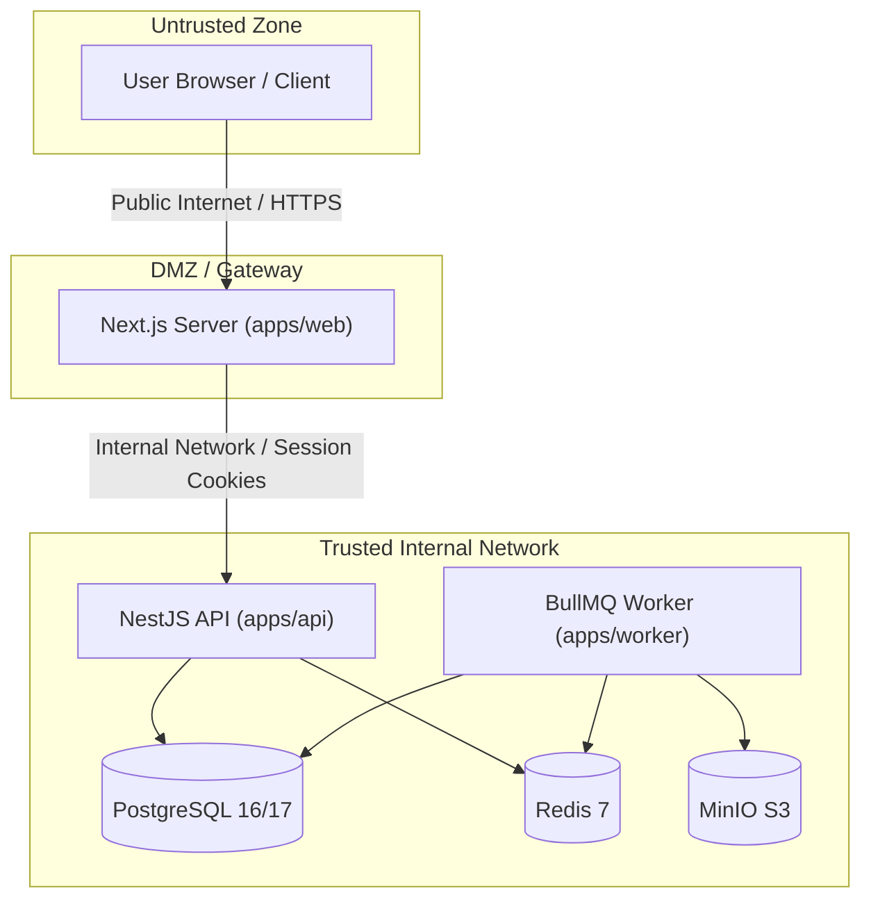

# Security Architecture & Threat Model: ShopScale

> **Authoritative Security Plan, Threat Model, and Defensive Controls**  
> Enforces multi-tenancy, authentication rigor, authorization boundaries, and data protection.

---

## 1. Assets, Actors & Trust Boundaries

### 1.1 Protected Assets
1. **Customer Accounts & Credentials**: Passwords, session tokens, refresh tokens, and recovery tokens.
2. **Customer Personal Data (PII)**: Delivery addresses, telephone numbers, and order histories.
3. **Financial Records**: Payment intent references, transaction receipts, refund balances, and seller payout accounting.
4. **Merchant Proprietary Data**: Unreleased draft products, private sales figures, margin calculations, and commission rates.
5. **System Infrastructure**: Database connection strings, JWT signing keys, and HMAC webhook secrets.

### 1.2 Actors & Capabilities
- **`Guest`**: Unauthenticated visitor. May read public catalog and maintain temporary guest cart.
- **`Customer`**: Authenticated shopper. Owns personal cart, addresses, orders, reviews, and wishlist.
- **`Seller Staff`**:
  - `owner`: Full control over merchant store, bank payout details, and staff invitations.
  - `manager`: Catalog management, order fulfillment, return approvals, and team view.
  - `catalog-editor`: Product and variant drafting/editing; cannot view orders or financials.
  - `fulfillment`: Access to packing and shipping workflows; cannot alter catalog or store settings.
- **`Support Agent`**: Platform employee inspecting customer orders and issuing discretionary refunds up to $200 (20,000 cents).
- **`Platform Administrator`**: Superuser approving seller accounts, configuring global category trees, and reviewing system audit logs.

### 1.3 Trust Boundaries


---

## 2. Authentication & Session Architecture

### 2.1 Password Hashing & Storage
- Algorithm: **Argon2id**.
- Parameters: `memoryCost: 65536` (64 MB), `timeCost: 3`, `parallelism: 4`.
- Enforces minimum 8-character passwords with complexity checks.
- Passwords are never logged or returned in any DTO response.

### 2.2 JWT Access & Refresh Token Rotation
- **Access Tokens**: Short-lived (15 minutes), signed with asymmetric RSA or strong HMAC-SHA256 secret. Contains `userId`, `email`, and `platformRoles`.
- **Refresh Tokens**: Long-lived (7 days), stored in PostgreSQL as SHA-256 hashes (`refresh_tokens.token_hash`). Raw tokens are sent only once to the client.
- **Session Families**: Every login initiates a `session_family`. When a refresh token is exchanged, a new token is generated and the previous token is marked `used_at = NOW()`.
- **Reuse Detection Protocol**: If a previously used refresh token is presented, the system detects a stolen token replay attack:
  1. Instantly revokes the entire `session_family`.
  2. Invalidate all active child sessions.
  3. Records a security alert in `audit_logs`.
  4. Returns `HTTP 401 Unauthorized`.

### 2.3 Cookie Transport & CSRF Protection
- Tokens are stored in `HttpOnly`, `SameSite=Lax`, `Secure` cookies.
- Mutating browser requests require a double-submit `X-CSRF-Token` header validated against an encrypted session cookie proof.

---

## 3. Authorization & Multi-Tenant Isolation

### 3.1 Authorization Matrix (RBAC & ABAC)

| Resource / Endpoint | Guest | Customer | Seller Editor | Seller Manager | Seller Owner | Support | Admin |
|---|:---:|:---:|:---:|:---:|:---:|:---:|:---:|
| `GET /v1/products` | Allow | Allow | Allow | Allow | Allow | Allow | Allow |
| `POST /v1/cart/items` | Allow (Guest) | Allow (User) | Deny | Deny | Deny | Deny | Deny |
| `POST /v1/checkout` | Deny | Allow | Deny | Deny | Deny | Deny | Deny |
| `GET /v1/orders/me` | Deny | Allow (Own) | Deny | Deny | Deny | Deny | Deny |
| `POST /v1/seller/products` | Deny | Deny | Allow (Own Store)| Allow (Own Store)| Allow (Own Store)| Deny | Allow (Any) |
| `GET /v1/seller/orders` | Deny | Deny | Deny | Allow (Own Items)| Allow (Own Items)| Allow (Any) | Allow (Any) |
| `POST /v1/seller/fulfill` | Deny | Deny | Deny | Allow (Own Store)| Allow (Own Store)| Deny | Allow (Any) |
| `POST /v1/support/refunds`| Deny | Deny | Deny | Deny | Deny | Allow (<= $200)| Allow (Any) |
| `POST /v1/admin/approve` | Deny | Deny | Deny | Deny | Deny | Deny | Allow |
| `GET /v1/admin/audit-logs`| Deny | Deny | Deny | Deny | Deny | Allow (Read) | Allow |

### 3.2 Tenant Data Isolation & The Uniform 404 Rule
- All store resources (`products`, `product_variants`, `orders`, `seller_orders`, `inventory`, `media_assets`) maintain composite keys `(store_id, id)`.
- SQL queries unconditionally enforce `WHERE store_id = :sessionStoreId`.
- **The Uniform 404 Rule**: If a user attempts to access or mutate a store resource where `store_id` does not match their verified membership, the API **unconditionally returns `HTTP 404 Not Found`** (identical to a non-existent ID). This prevents attackers from enumerating store IDs or determining product existence.

### 3.3 Customer PII Masking
- When a seller views orders containing their items, customer personal information (delivery street address, phone number, customer email) is **masked**:
  ```json
  {
    "recipient": "J*** D**",
    "city": "Seattle",
    "state": "WA",
    "postalCode": "981**"
  }
  ```
- Full delivery address is revealed to the seller's fulfillment staff *only* after the order status reaches `PAID`.

---

## 4. Input Validation & Defense-in-Depth

### 4.1 Schema Validation Boundaries
- All HTTP requests entering NestJS are validated against strict Zod schemas defined in `@shopscale/contracts`.
- Unrecognized query parameters or payload properties are stripped or rejected (`strip` / `strict`).
- Monetary values are validated as non-negative integer cents.
- String inputs enforce bounded lengths (e.g., product titles <= 200 characters, search queries <= 100 characters).

### 4.2 Rate Limiting & Brute-Force Defenses
- Engine: Redis sliding-window counter via `@shopscale/backend/src/identity/rate-limit.ts`.
- Rules:
  - `POST /v1/auth/login`: 5 failed attempts per IP / per email per 15 minutes.
  - `POST /v1/auth/password-reset`: 3 requests per email per hour.
  - `POST /v1/checkout`: 10 requests per user per minute.
  - Public Catalog APIs: 1,000 requests per IP per minute.
- Responses on breach: `HTTP 429 Too Many Requests` with standard `Retry-After: <seconds>` header.

### 4.3 Idempotency & Replay Protection
- Mutating endpoints (`/checkout`, payment actions) mandate an `Idempotency-Key` header (UUID format).
- Key, actor ID, and SHA-256 hash of the request body are stored in `idempotency_requests`.
- If a duplicate request arrives with matching hash: returns the cached response with `X-Cache: HIT`.
- If a duplicate request arrives with mismatched hash: returns `HTTP 409 Conflict (IDEMPOTENCY_MISMATCH)`.

---

## 5. Webhook, Upload & Infrastructure Security

### 5.1 Webhook Signature Verification (`TASK-050`)
- Inbound payment callbacks (`POST /v1/webhooks/payments`) are signed with HMAC-SHA256:
  $$\text{Signature} = \text{HMAC-SHA256}(secret, timestamp + "." + rawBody)$$
- The webhook receiver validates:
  1. Header `X-ShopScale-Timestamp` is within a 5-minute tolerance window (prevents replay attacks).
  2. Computed HMAC matches `X-ShopScale-Signature` using timing-safe comparison (`crypto.timingSafeEqual`).
  3. Events are deduplicated against `webhook_events(provider, event_id)`.

### 5.2 Presigned Upload Security (`TASK-035`)
- Product image uploads use presigned S3/MinIO URLs with short lifespans (15 minutes).
- Uploaded objects are quarantined until validated:
  - Magic byte sniffing verifies actual file content matches allowed raster image formats (`image/jpeg`, `image/png`, `image/webp`).
  - Raw SVG uploads are **strictly disabled** in V1 to prevent Stored Cross-Site Scripting (XSS) via embedded XML `<script>` tags.
  - Max file size capped at 10 MB.

### 5.3 Secret Management & Logging Redaction
- Zero secrets committed to Git repository (`.env.example` contains only placeholder keys).
- Boot-time validation via `@shopscale/config` ensures all required secrets (`JWT_SECRET`, `SESSION_SECRET`, `WEBHOOK_SECRET`) meet minimum entropy requirements.
- Logging filters automatically redact sensitive fields (`password`, `token`, `secret`, `authorization`, `creditCard`, `rawBody`).
- Privileged mutations are permanently recorded in an append-only `audit_logs` table.
